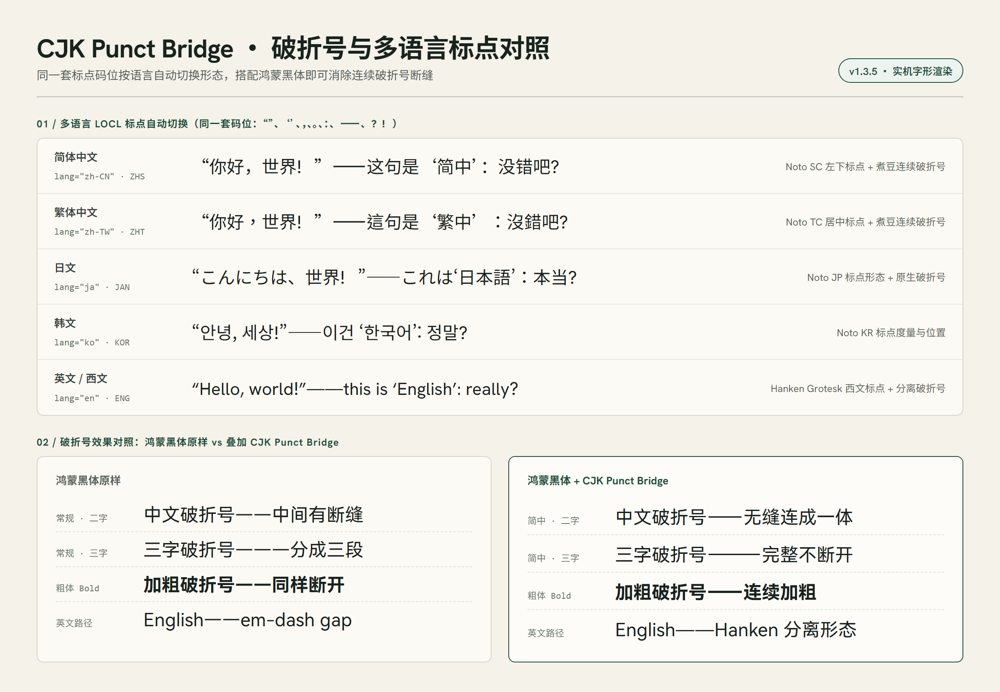

# CJK Punct Bridge

**面向中西文混排的语言感知标点桥接字体。** 将它放在 CSS 字体栈最前方并为文本标注语言，即可在同一套网页或排版环境中自动为简体中文、繁体中文、日文、韩文与西文各自选用地道标点，而无需更换正文字体。

> 本项目是纯粹的标点伴随字体：有意不收录拉丁字母、汉字、假名、谚文、ASCII 数字与连字符 `U+002D`，将这些字符完整交还给字体栈中的后续字体渲染。

当前版本为 **`v1.3.5`**，所有发行包均可通过 [GitHub Releases](https://github.com/Speechlessmanbilibili/CJK-Punct-Bridge/releases/latest) 获取。



## 三个发行家族怎么选？

每次 Release 会同时提供 3 个独立家族，每套均包含 **正斜体单轴可变字体（`wght` `100～900`）**、**正斜体各 9 个静态字重（Thin 100 ～ Black 900）**，以及对应的 **`WOFF2` 网页格式**：

| 家族名称 | 发行包 | 核心用途 | `U+203D` / `?!` 连字 |
| --- | --- | --- | --- |
| **CJK Punct Bridge** | `CJKPunctBridge-v1.3.5.zip` | 默认主版本：完整的语言感知中日韩 / 西文标点与连续破折号桥接 | 无 |
| **CJK Punct Bridge ?!** | `CJKPunctBridgeInterrobang-v1.3.5.zip` | 在标准版基础上增加 `?!`、`!?`、`？！`、`！？` 自动连字与 `U+203D` 直接支持 | 有 |
| **Interrobang Bridge** | `InterrobangBridge-v1.3.5.zip` | 极简伴随版：仅收录 `!`、`?`、`¡`、`¿`、`！`、`？` 与 `U+203D`（共 7 个码位） | 有 |

## 为什么需要标点桥接字体？

许多标点在 Unicode 中共享同一个码位，但简体中文、繁体中文、日文、韩文与西文对字形轮廓、占宽及基线对齐的要求各不相同。传统字体回退栈只认码位、不认语言，混排时往往只能“一种标点走天下”。

CJK Punct Bridge 利用 OpenType `locl` 语言系统特性化解这一问题：

- **中日韩各自独立**：简中、繁中 / 港澳、日文、韩文分别取自 Google Fonts 官方 Noto Sans SC / TC / JP / KR。
- **西文自动切换**：在显式西文语言标签下，与 Hanken Grotesk 共享的 46 个标点自动切换为 Hanken Grotesk 轮廓。
- **问号与感叹号统一**：所有路径下的 `!`、`?`、`¡`、`¿`、`！`、`？` 均采用字重匹配的 Inter 4.001 轮廓，全角形式保留 1000 单位字宽。
- **连续破折号**：简繁中文路径下的 `U+2014`（`—`）、`U+2E3A`（`⸺`）与 `U+2E3B`（`⸻`）采用源自煮豆黑体的破折号轮廓，连续输入保持不断开。

## 网页使用方式

1. 声明字体家族并置于正文字体之前，开启 `locl` 特性：

```css
@font-face {
  font-family: "CJK Punct Bridge";
  src: url("./CJKPunctBridge-Variable.woff2") format("woff2-variations");
  font-style: normal;
  font-weight: 100 900;
  font-display: swap;
}
@font-face {
  font-family: "CJK Punct Bridge";
  src: url("./CJKPunctBridge-Italic-Variable.woff2") format("woff2-variations");
  font-style: italic;
  font-weight: 100 900;
  font-display: swap;
}

body {
  font-family:
    "CJK Punct Bridge",
    "Hanken Grotesk",
    "Noto Sans SC",
    sans-serif;
  font-feature-settings: "locl" 1;
}
```

> 斜体家族中的西文标点采用真正的 Hanken Grotesk Italic 设计；中日韩标点与煮豆破折号采用统一的 10 度人工倾斜。

2. 为不同语言文本标注准确的 `lang` 属性，让排版引擎激活对应分支：

```html
<p lang="zh-CN">简体中文，使用简体中文标点。</p>
<p lang="zh-TW">繁體中文，使用繁體中文標點。</p>
<p lang="ja">日本語の句読点。</p>
<p lang="ko">한국어 문장 부호.</p>
<p lang="en">English punctuation from Hanken Grotesk.</p>
```

## 语言与字源映射

| 文本语言或 OpenType 路径 | 标点字源 |
| --- | --- |
| 缺失语言 / 脚本默认 `LangSys` | Google Fonts Noto Sans SC |
| 简体中文、汉语拼音（`ZHS`、`ZHP`） | Google Fonts Noto Sans SC |
| 繁体中文、中国香港、中国澳门（`ZHT`、`ZHH`、`ZHTM`） | Google Fonts Noto Sans TC |
| 日文（`JAN`） | Google Fonts Noto Sans JP |
| 韩文、古谚文（`KOR`、`KOH`） | Google Fonts Noto Sans KR |
| Common / Latin / Cyrillic / Greek 下的显式西文语言 | 覆盖范围内选用 Google Fonts Hanken Grotesk |

已配置的西文路径覆盖项目常用地区、现代与历史西文语言集合，以及锁定 Hanken 字源中的所有显式语言系统；脚本默认 `LangSys` 始终保持为 Noto Sans SC，绝不会改写为西文标点。

## 排版与兼容细节

- **字符边界**：保留 `ccmp`、`dlig`、字宽特性与地区竖排 `vert` / `vrt2`；刻意排除 ASCII 数字 `U+0030～U+0039` 与 `U+002D` 连字符，确保数字与连字符始终回落至常规西文字体。
- **西文破折号分离**：西文语言路径保留 Hanken Grotesk 原生破折号，不触发中日韩连续破折号连字。
- **双槽位疑问叹号**：`CJK Punct Bridge ?!` 与 `Interrobang Bridge` 采用 `500 + 0`（半角 `?!` / `!?`）与 `1000 + 0`（全角 `？！` / `！？`）的上下文双替换策略，在保留两个源字符槽位的同时，无需依赖 GDEF 即可让中间光标准确贴合可见字形右缘；同时支持直接输入 `U+203D`（`‽`）。

## 本地构建与校验

所有发行版二进制文件均由哈希锁定的上游字源生成，不提交至 Git 源码历史：

```bash
# 1. 拉取上游字源至 upstream/（仅首次需要联网）
python scripts/fetch_sources.py

# 2. 构建标准版正体与斜体
python scripts/build.py
CJK_PUNCT_ITALIC=1 python scripts/build.py

# 3. 运行发行审计与破折号矩阵校验
python scripts/audit_release.py fonts/static/CJKPunctBridge-Regular.ttf fonts/variable/CJKPunctBridge-Variable.ttf
python scripts/check_dash_matrix.py fonts/static/CJKPunctBridge-Regular.ttf fonts/variable/CJKPunctBridge-Variable.ttf

# 4. 可选：构建 ?! 变体与 Interrobang Bridge 附件（需先在 upstream/ 备妥 Inter 4.001 可变字体）
python scripts/build_interrobang.py
CJK_PUNCT_ITALIC=1 python scripts/build_interrobang.py
python scripts/build_interrobang_bridge.py
INTERROBANG_BRIDGE_ITALIC=1 python scripts/build_interrobang_bridge.py
```

详细文档：

- [BUILDING.md](BUILDING.md) — 构建管线、斜体倾斜处理与合并策略说明
- [SOURCES.md](SOURCES.md) — 锁定的上游字体版本与 SHA-256 校验值
- [FONTLOG.md](FONTLOG.md) — 各版本完整更新记录
- [scripts/README.md](scripts/README.md) — 各个构建与审计脚本用途说明
- [fonts/README.md](fonts/README.md) — 发行包目录结构说明

## 许可证

本项目基于 [SIL Open Font License 1.1](OFL.txt) 发布。本字体为修改与组合衍生作品，并非 Hanken Grotesk、Noto / Source Han、煮豆黑体或 Inter 的官方发行版；详细署名见 [THIRD_PARTY_NOTICES.md](THIRD_PARTY_NOTICES.md)。
